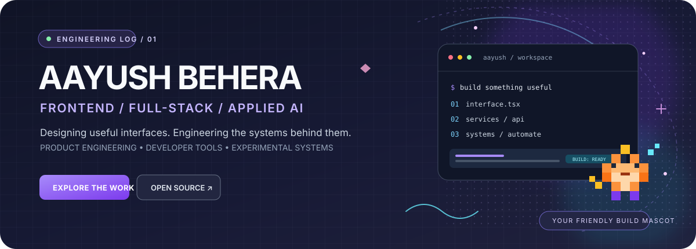
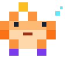
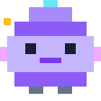
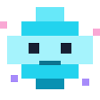
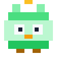

<!--
  Aayush Behera — GitHub profile
  Visual direction: indie engineering studio / pixel-illustrated control room.
  Assets in assets/visual are original SVG artwork created for this profile.
-->

  

  <a href="https://github.com/AayushBehera?tab=repositories">PROJECT ARCHIVE</a>
  &nbsp; ◇ &nbsp;
  <a href="https://in.linkedin.com/in/aayush-behera-203928371">LINKEDIN</a>
  &nbsp; ◇ &nbsp;
  <a href="https://github.com/AayushBehera">GITHUB</a>
   
  Independent builder's log · Interface craft × systems thinking × applied AI

---

<table>
  <tr>
    <td width="68%" valign="top">
      <h2>01 / The builder</h2>
      I'm **Aayush**, a frontend and full-stack engineer interested in the space between thoughtful interface design and the systems that make products work.

      I work across product interfaces, backend integrations, developer tools and applied AI. I care about visual detail, clear architecture, and software that behaves as well as it looks.

       
      <strong>Design instinct:</strong> crisp interfaces, strong hierarchy, useful motion, and a little personality.
    </td>
    <td width="32%" align="center" valign="middle">
      
       
      <strong>BYTE FOX</strong>
       
      Curious by design.
    </td>
  </tr>
</table>

  
  
  
   
  THE LITTLE CREW · DESIGN DETAILS WITH A PURPOSE

## 02 / Featured builds

A few projects that represent the range of problems I like working on.

<table>
  <tr>
    <td width="50%" valign="top">
      
      01 — DEVELOPER TOOLING
      <h3><a href="https://github.com/AayushBehera/ArrowEra-Error-mechanism">ArrowEra Error Mechanism</a></h3>
      A diagnostic workbench for stack traces: deterministic analysis, transparent reasoning paths and actionable fixes.

      React · TypeScript · Vite · Node.js
        
      <a href="https://github.com/AayushBehera/ArrowEra-Error-mechanism">VIEW SOURCE ↗</a>
    </td>
    <td width="50%" valign="top">
      
      02 — SECURITY ENGINEERING
      <h3><a href="https://github.com/AayushBehera/phishing-forensics">Phishing Forensics</a></h3>
      An email threat-analysis workflow linking a Chrome extension, analysis backend and security operations dashboard.

      Next.js · Express · Gemini API · Chrome Extension
        
      <a href="https://github.com/AayushBehera/phishing-forensics">VIEW SOURCE ↗</a>
    </td>
  </tr>
  <tr>
    <td width="50%" valign="top">
      
      03 — WEB ARCHITECTURE
      <h3><a href="https://github.com/AayushBehera/ArrowERA-CMS">ArrowERA CMS</a></h3>
      A modern CMS project exploring an Astro and TypeScript architecture with serverless-oriented components.

      Astro · TypeScript · Cloudflare-compatible design
        
      <a href="https://github.com/AayushBehera/ArrowERA-CMS">VIEW SOURCE ↗</a>
    </td>
    <td width="50%" valign="top">
      
      04 — NETWORKING RESEARCH
      <h3><a href="https://github.com/AayushBehera/Self-Healing-SDN-With-RL-Based-Learning">Self-Healing SDN</a></h3>
      A research implementation for telemetry-driven fault recovery and traffic rerouting in a software-defined network.

      Python · Ryu · OpenFlow · Mininet · PPO
        
      <a href="https://github.com/AayushBehera/Self-Healing-SDN-With-RL-Based-Learning">VIEW SOURCE ↗</a>
    </td>
  </tr>
</table>

  ✳ &nbsp; EXPERIMENTS, ITERATIONS AND OPEN-SOURCE WORK LIVE IN THE <a href="https://github.com/AayushBehera?tab=repositories">FULL REPOSITORY ARCHIVE</a> &nbsp; ✳

---

## 03 / Engineering toolkit

<table>
  <tr>
    <td width="50%" valign="top">
      <strong>◈ INTERFACE & EXPERIENCE</strong> 
      React · Next.js · TypeScript · JavaScript · HTML · CSS · Tailwind CSS · Three.js
    </td>
    <td width="50%" valign="top">
      <strong>⌘ BACKEND & DATA</strong> 
      Node.js · Python · FastAPI · REST APIs · PostgreSQL · SQLite
    </td>
  </tr>
  <tr>
    <td width="50%" valign="top">
      <strong>✳ APPLIED AI</strong> 
      LLM integrations · Ollama · OpenAI API · RAG concepts · workflow automation
    </td>
    <td width="50%" valign="top">
      <strong>⚙ SYSTEMS & DELIVERY</strong> 
      Git · GitHub Actions · Docker · Linux · Vite
    </td>
  </tr>
</table>

## 04 / Experience log

| Team | Role | Focus |
|---|---|---|
| **Chart Sentinel** | Contract Web Developer | Trading dashboards and analytics interfaces |
| **Sandbox Scholars** | Frontend Developer · Contract | Responsive frontend and reusable UI components |
| **Ageix Partners** | Web Analytics Developer · Contract | Analytics integrations and data visualization |
| **The Failure Story** | Content Writer | Technical narratives and developer-focused content |

Dates and quantified outcomes are intentionally omitted until they can be verified and published.

## 05 / Outside the interface

  
  
  

I enjoy exploring the details that make software feel considered: clear interaction patterns, useful developer experiences, resilient integrations and playful visual systems that do not get in the way of the work.

---

  <strong>LET'S BUILD SOMETHING THAT WORKS — AND FEELS GOOD TO USE.</strong>
    
  <a href="https://github.com/AayushBehera?tab=repositories">Browse projects</a>
  &nbsp; · &nbsp;
  <a href="https://in.linkedin.com/in/aayush-behera-203928371">Connect on LinkedIn</a>
    
  Profile art & layout crafted for Aayush Behera · SVG pixel crew · v2.0

