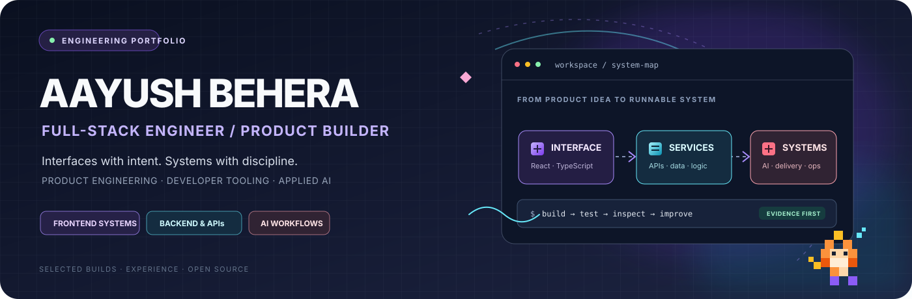
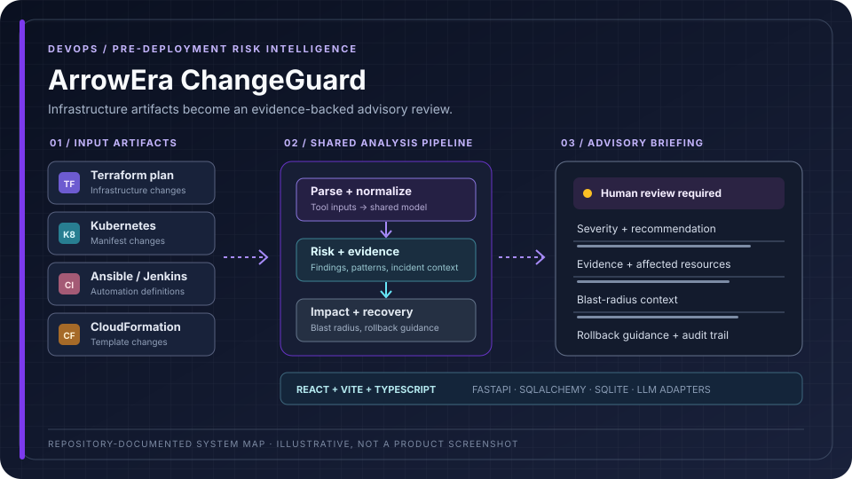
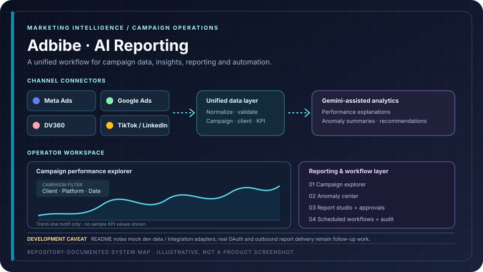
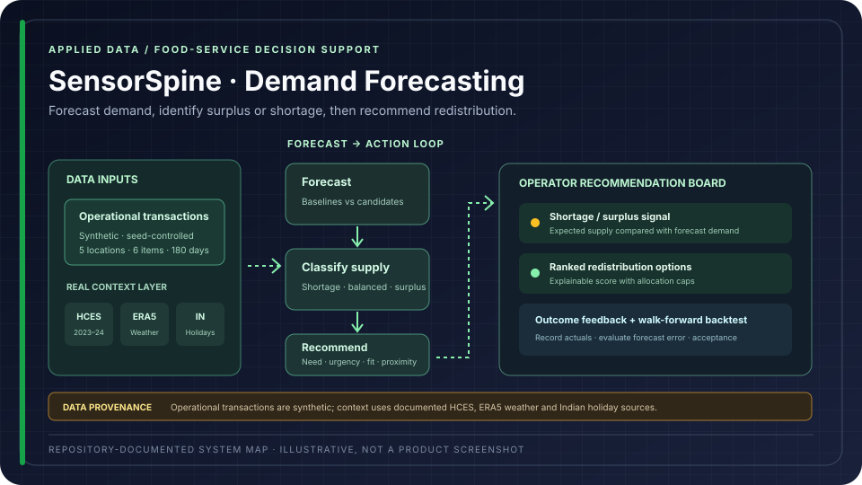
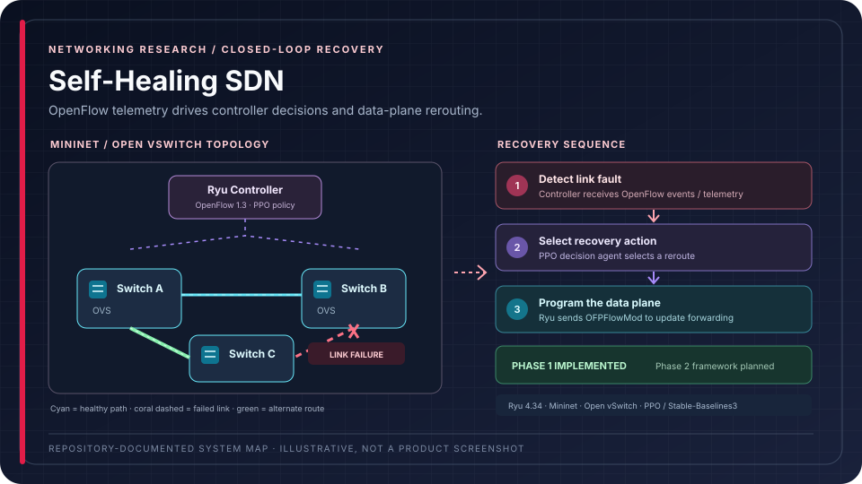
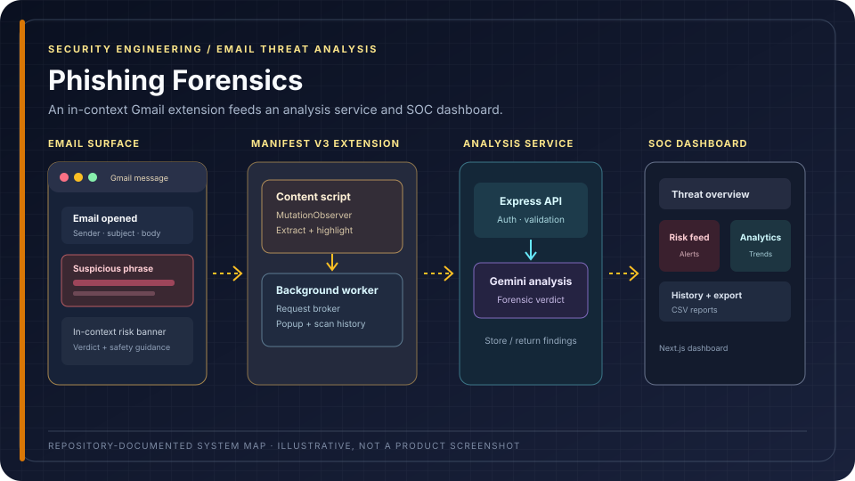
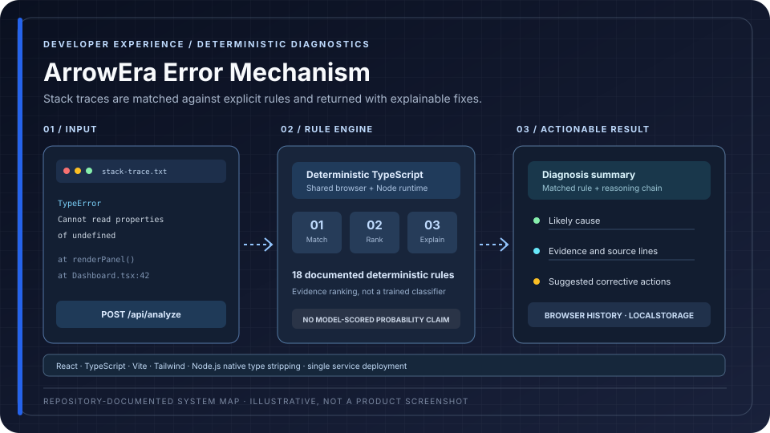

<!--
  Aayush Behera | Engineering portfolio
  Visual system: Orbit / Ink / Violet / Cyan
  All profile graphics are original, static SVGs in assets/profile/.
  Project visuals are repository-based system diagrams, not application screenshots.
-->

  

  <a href="https://github.com/AayushBehera?tab=repositories">PROJECT ARCHIVE</a>
  &nbsp; · &nbsp;
  <a href="https://in.linkedin.com/in/aayush-behera-203928371">LINKEDIN</a>
  &nbsp; · &nbsp;
  <a href="https://github.com/AayushBehera">GITHUB</a>
   
  Product engineering · Developer tooling · Applied AI · Infrastructure

---

## Profile

I'm Aayush Behera, a full-stack engineer focused on building useful product interfaces and the backend systems behind them. My work spans dashboard and workflow design, API integration, developer tooling, data-driven applications, and applied AI.

I approach projects from both sides: the user experience needs to be clear, and the underlying implementation needs to be understandable, testable, and honest about its limits.

  

## Experience

| Organisation | Role | Scope of work |
|---|---|---|
| **Chart Sentinel** | Contract Web Developer | Trading-intelligence dashboard interfaces, real-time analytics views, and product-facing UI work |
| **Sandbox Scholars** | Frontend Developer · Contract | Responsive frontend experiences and reusable component work for an education platform |
| **Ageix Partners** | Web Analytics Developer · Contract | Analytics integrations and data-visualisation layers for business reporting |
| **The Failure Story** | Content Writer | Technical narratives and developer-focused content |

These are the roles and responsibilities currently listed in my profile. Dates and quantified outcomes are not shown because I do not have verified public date ranges or impact figures to publish.

## Selected engineering work

The diagrams below explain each project's documented architecture and workflow. They are deliberately labelled as system maps rather than screenshots. Repository links are provided as the source of truth for code, setup instructions, and implementation status.

<table>
  <tr>
    <td width="50%" valign="top">
      
      <h3><a href="https://github.com/AayushBehera/arrowera-change-guard">ArrowEra ChangeGuard</a></h3>
      **Pre-deployment risk intelligence**

      Reviews infrastructure changes across Terraform, Kubernetes, Ansible, Jenkins, and CloudFormation. A shared analysis pipeline produces risk findings, affected-resource context, blast-radius information, rollback guidance, and an auditable advisory brief.

      **My engineering focus:** repository-first DevOps workflows, evidence-backed analysis, risk presentation, and human-in-the-loop remediation boundaries.

      React 18 · Vite · TypeScript · FastAPI · SQLAlchemy · SQLite · LLM adapters

      **Status:** the repository README documents release v1.4.0. Recommendations remain advisory; the tool does not autonomously approve or deploy changes.

      <a href="https://github.com/AayushBehera/arrowera-change-guard">SOURCE & DOCUMENTATION ↗</a>
    </td>
    <td width="50%" valign="top">
      
      <h3><a href="https://github.com/AayushBehera/report-automation">Adbibe · AI Reporting Platform</a></h3>
      **Marketing analytics and reporting workflows**

      A multi-client reporting workspace covering campaign exploration, cross-channel performance analysis, anomaly review, AI-generated explanations, report creation, scheduled workflows, integration monitoring, and audit history.

      **My engineering focus:** campaign analytics surfaces, reporting workflows, AI-assisted insight presentation, and the integration layer.

      React 19 · TypeScript · Vite · Tailwind CSS · Express · Gemini · Firebase · Recharts

      **Status:** development project. Its README identifies mock development data and mock integration adapters; production OAuth flows and outbound report delivery remain follow-up work.

      <a href="https://github.com/AayushBehera/report-automation">SOURCE & DOCUMENTATION ↗</a>
    </td>
  </tr>
  <tr>
    <td width="50%" valign="top">
      
      <h3><a href="https://github.com/AayushBehera/sensorspine-demand-forcasting-project">SensorSpine · Demand Forecasting</a></h3>
      **Food-service demand and surplus redistribution**

      Runs a forecasting pipeline, compares candidate models with baselines, classifies expected shortage or surplus, and ranks redistribution options using need, urgency, quantity fit, proximity, and compatibility. The workflow records outcomes and supports walk-forward backtesting.

      **Data integrity:** operational transaction rows are synthetic and explicitly labelled as such. The contextual layer uses documented HCES 2023–24 consumption data, ERA5 weather, and the Indian public-holiday calendar. Live POS transactions are not yet connected.

      Python · FastAPI · SQLite · Forecast evaluation · Feature engineering

      <a href="https://github.com/AayushBehera/sensorspine-demand-forcasting-project">SOURCE, DATA NOTES & API ↗</a>
    </td>
    <td width="50%" valign="top">
      
      <h3><a href="https://github.com/AayushBehera/Self-Healing-SDN-With-RL-Based-Learning">Self-Healing SDN</a></h3>
      **Reinforcement-learning-assisted network recovery**

      Implements a closed-loop fault-recovery path: a Ryu controller reads OpenFlow telemetry, detects link faults, selects a recovery action through a PPO-based agent, and issues OFPFlowMod updates to reroute traffic through a healthy path. The repository also documents event-driven and OpenFlow fast-failover baselines.

      **Research status:** Phase 1 recovery system and paper are marked complete in the repository; the broader multi-agent framework is planned as Phase 2.

      Python · Ryu · OpenFlow 1.3 · Mininet · Open vSwitch · PPO

      <a href="https://github.com/AayushBehera/Self-Healing-SDN-With-RL-Based-Learning">SOURCE, EXPERIMENTS & PAPER ↗</a>
    </td>
  </tr>
  <tr>
    <td width="50%" valign="top">
      
      <h3><a href="https://github.com/AayushBehera/phishing-forensics">Phishing Forensics</a></h3>
      **Email threat analysis and SOC visibility**

      Combines a Manifest V3 Chrome extension, an Express analysis backend, and a Next.js security dashboard. The extension observes opened Gmail messages, forwards email content through a background service worker, and displays verdicts and suspicious-phrase highlights in context. The dashboard provides threat history, analytics, and CSV export.

      Chrome Extension · JavaScript · Express · Gemini · Next.js · SQLite / PostgreSQL adapters

      <a href="https://github.com/AayushBehera/phishing-forensics">SOURCE & SETUP ↗</a>
    </td>
    <td width="50%" valign="top">
      
      <h3><a href="https://github.com/AayushBehera/ArrowEra-Error-mechanism">ArrowEra Error Mechanism</a></h3>
      **Deterministic error triage and diagnosis**

      Accepts an error message or stack trace and returns a transparent diagnosis with a reasoning chain and actionable fixes. The browser and Node runtime share the same TypeScript diagnostic engine, preserving a single rules implementation.

      **Implementation detail:** the repository documents 18 deterministic rules. Its heuristic score is an evidence-ranking aid, not a calibrated probability. Browser history uses localStorage; server-side database persistence is intentionally deferred.

      React · TypeScript · Vite · Tailwind CSS · Node.js

      <a href="https://github.com/AayushBehera/ArrowEra-Error-mechanism">SOURCE, API & TESTS ↗</a>
    </td>
  </tr>
</table>

## Open-source contributions

Two merged changes in **claude-mem** focus on reliable transcript processing and durable state:

| Contribution | What changed | Status |
|---|---|---|
| [PR #4192](https://github.com/thedotmack/claude-mem/pull/4192) · Transcript checkpoint handling | Separated the live read cursor from the durable restart checkpoint, preserving incomplete JSONL records and byte-accurate offsets, including multibyte text | **Merged · 1 Oct 2026** |
| [PR #4193](https://github.com/thedotmack/claude-mem/pull/4193) · Atomic transcript state | Moved watch-state writes to the repository's atomic JSON writer and added regression coverage | **Merged · 1 Oct 2026** |

**Aider contributions under review:** [PR #5602](https://github.com/Aider-AI/aider/pull/5602) covers CI, Docker, and compatibility hardening; [PR #5750](https://github.com/Aider-AI/aider/pull/5750) covers the PyPI version matrix. Both were open when this profile was revised and are not presented as merged work.

## Technical toolkit

| Area | Technologies documented in my public projects |
|---|---|
| **Frontend & product UI** | React, Next.js, TypeScript, JavaScript, Vite, Tailwind CSS |
| **Backend & APIs** | Node.js, Express, Python, FastAPI, REST APIs |
| **Data & analytics** | SQLite, SQLAlchemy, PostgreSQL adapters, feature engineering, forecasting evaluation |
| **AI integrations** | Gemini, Ollama, OpenAI-compatible APIs, LLM-assisted analysis |
| **Infrastructure & research** | Docker, GitHub Actions, Trivy, Linux, Ryu, OpenFlow, Mininet, Stable-Baselines3 / PPO |

## Additional projects

- [MindFrame](https://github.com/AayushBehera/MindFrame-A-CBT-Inspired-Cognitive-Distortion-Analyzer-using-Python-and-SQL) — a Python and SQLite mini-project for recording thoughts, tagging CBT-inspired cognitive distortions, saving reframed thoughts, and inspecting patterns with SQL.
- [ArrowERA CMS](https://github.com/AayushBehera/ArrowERA-CMS) — an Astro and TypeScript CMS monorepo exploring serverless-oriented database, authentication, and plugin packages.
- [ArrowEra Code AI](https://github.com/AayushBehera/ArrowEra-Code-AI) — an ongoing AI tooling direction documented around local/cloud model providers, code workflows, and a unified interface. See the repository for the current implementation scope.

---

  <strong>BUILDING SOFTWARE THAT IS USEFUL, UNDERSTANDABLE, AND WELL-DESIGNED.</strong>
    
  <a href="https://github.com/AayushBehera?tab=repositories">Explore all repositories</a>
  &nbsp; · &nbsp;
  <a href="https://in.linkedin.com/in/aayush-behera-203928371">Connect on LinkedIn</a>
    
  Static SVG illustrations · Evidence-linked project cards · No fabricated activity metrics

